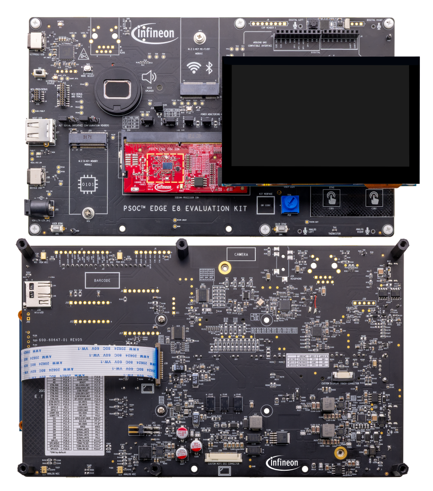
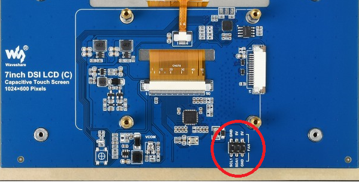
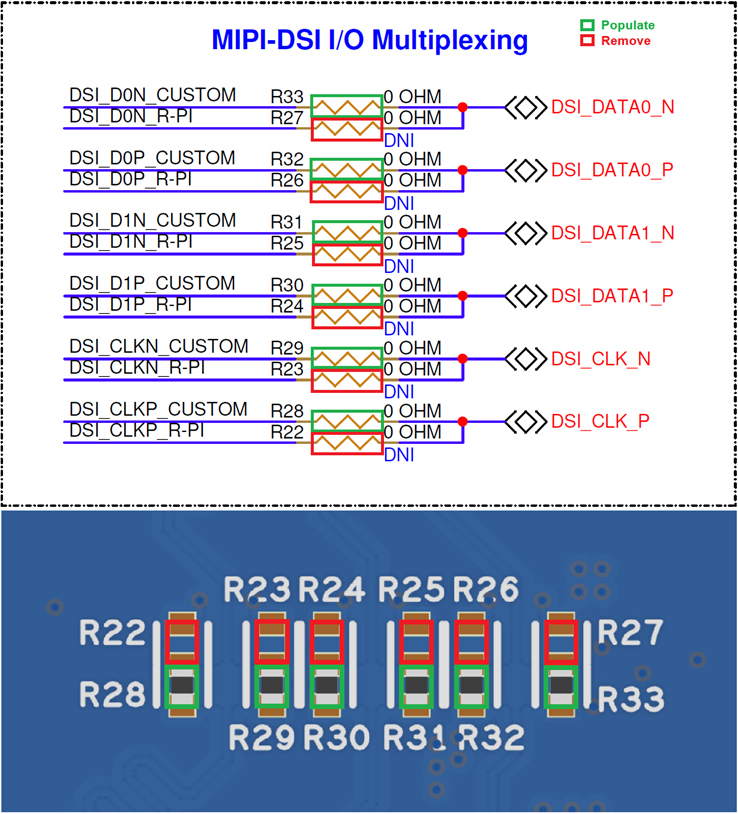
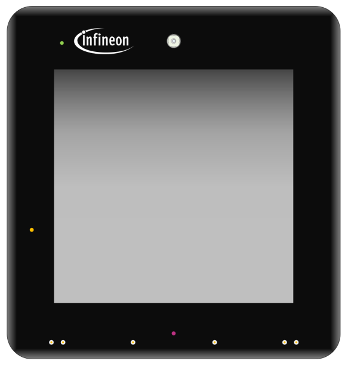

# PSOC&trade; Edge MCU: LVGL multi-screen state machine with transitions

This code example demonstrates a multi-screen LVGL application on the PSOC&trade; Edge MCU, with spring transitions, page lifecycle events, and run-time themes. The following displays are supported.

- Waveshare 4.3-inch Raspberry Pi DSI 800x480 pixel display
- Waveshare 7-inch Raspberry Pi DSI LCD C 1024x600 pixel display
- 10.1 inch 1024x600 TFT display (WF101JTYAHMNB0)
- ST7701S 4-inch MIPI DSI 480x480 pixel display (RK040HF001)

The application is a point-of-sale terminal with six pages (New sale, Basket, Payment, Receipt, Ad hoc, Settings). The basket shows fixed demo items that stand in for goods scanned at the till, so there is no on-screen item entry; the **Ad hoc** page keys in an amount instead. See [Design and implementation](docs/design_and_implementation.md) for the reusable features, architecture, and configuration details.

This code example has a three project structure: CM33 secure, CM33 non-secure, and CM55 projects. All three projects are programmed to the external QSPI flash and executed in Execute-in-Place (XIP) mode. Extended boot launches the CM33 secure project from a fixed location in the external flash, which then configures the protection settings and launches the CM33 non-secure application. Additionally, CM33 non-secure application enables CM55 CPU and launches the CM55 application. The CM55 application implements the logic for this code example.
> **Note:** 
>- On KIT_PSE84_HMI, all three projects are programmed to the external OSPI flash instead of QSPI  
>- This application builds for the 4.3-inch display by default for all BSPs except KIT_PSE84_HMI. For KIT_PSE84_HMI, the `CONFIG_DISPLAY` is set to `R4INCH_DISP` by default. To build for a different panel, change `CONFIG_DISPLAY` in *common.mk* as described in **Step 4** of the [Operation](#operation) section

[View this README on GitHub.](https://github.com/Infineon/mtb-example-psoc-edge-gfx-lvgl-multiscreen-pos)

[Provide feedback on this code example.](https://yourvoice.infineon.com/jfe/form/SV_1NTns53sK2yiljn?Q_EED=eyJVbmlxdWUgRG9jIElkIjoiQ0UyNDM3MTYiLCJTcGVjIE51bWJlciI6IjAwMi00MzcxNiIsIkRvYyBUaXRsZSI6IlBTT0MmdHJhZGU7IEVkZ2UgTUNVOiBMVkdMIG11bHRpLXNjcmVlbiBzdGF0ZSBtYWNoaW5lIHdpdGggdHJhbnNpdGlvbnMiLCJyaWQiOiJzcmlrYW50aC5kc0BpbmZpbmVvbi5jb20iLCJEb2MgdmVyc2lvbiI6IjEuMC4wIiwiRG9jIExhbmd1YWdlIjoiRW5nbGlzaCIsIkRvYyBEaXZpc2lvbiI6Ik1DRCIsIkRvYyBCVSI6IklDVyIsIkRvYyBGYW1pbHkiOiJQU09DIn0=)

## Requirements

- [ModusToolbox&trade;](https://www.infineon.com/modustoolbox) v3.7 or later (tested with v3.9)
- Board support package (BSP) minimum required version: 1.4.0
- Programming language: C
- Associated parts: All [PSOC&trade; Edge MCU](https://www.infineon.com/products/microcontroller/32-bit-psoc-arm-cortex/32-bit-psoc-edge-arm) parts


## Supported toolchains (make variable 'TOOLCHAIN')

- GNU Arm&reg; Embedded Compiler v14.2.1 (`GCC_ARM`) – Default value of `TOOLCHAIN`
- Arm&reg; Compiler v6.22 (`ARM`)
- IAR C/C++ Compiler v9.70.4 (`IAR`)
- Arm&reg; Toolchain for Embedded v22.1 (`LLVM_ARM`)


## Supported kits (make variable 'TARGET')

- [PSOC&trade; Edge E84 Evaluation Kit](https://www.infineon.com/KIT_PSE84_EVAL) (`KIT_PSE84_EVAL_EPC2`) – Default value of `TARGET`
- [PSOC&trade; Edge E84 Evaluation Kit](https://www.infineon.com/KIT_PSE84_EVAL) (`KIT_PSE84_EVAL_EPC4`)
- [PSOC&trade; Edge E84 AI Kit](https://www.infineon.com/KIT_PSE84_AI) (`KIT_PSE84_AI`)
- [PSOC&trade; Edge E84 HMI Kit](https://www.infineon.com/KIT_PSE84_HMI) (`KIT_PSE84_HMI`)


## Hardware setup

This example uses the board's default configuration. See the kit user guide to ensure that the board is configured correctly.

Ensure the following jumper and pin configuration on the  board:
- BOOT SW must be in the HIGH/ON position
- J20 and J21 must be in the tristate/not connected (NC) position for the PSOC&trade; Edge E84 Evaluation Kit

> **Note:** This hardware setup is not required for KIT_PSE84_AI.

### Supported display and electrical connection
**1. Waveshare 4.3 inch Raspberry Pi DSI 800*480 pixel display:**  
This display is supported by default <br>

   Connect the FPC 15-pin cable between the display connector and the PSOC&trade; Edge E84 kit's RPi MIPI DSI connector as shown in **Figure 1** <br>

   **Table 1. Cable connection between display connector and kit**

   Kit name                                      | DSI connector
   ----------------------------------------------- | --------------
   PSOC&trade; Edge E84 Evaluation Kit             | J39
   PSOC&trade; Edge E84 AI Kit                     | J10

   **Figure 1.  Display connection with PSOC&trade; Edge E84 Evaluation Kit**

   

**2. Waveshare 7-inch Raspberry-Pi DSI LCD C 1024*600 pixel display:** <br>

   In this display, few I2C connections are present on the header named `FAN` on display's hardware, it is highlighted in **Figure 2** <br>

   **Figure 2. Waveshare 7-inch Raspberry Pi DSI LCD (C) display's I2C connection (FAN connector)**

   

   Interface the display with the PSOC&trade; Edge E84 kit's using the connections outlined in **Table 2** <br>

   > **Note:** For the PSOC&trade; Edge E84 AI Kit, populate the header at J16

   **Table 2: PSOC&trade; Edge E84 kit's connections**

   Display Connector | PSOC&trade; Edge E84 Evaluation Kit connector | PSOC&trade; Edge E84 AI Kit connector
   ------------------|-----------------------------------------------|----------------------------
   DSI connector     | J39                                           | J10
   GND (FAN)         | GND (J41.1)                                   | GND (J16.3)
   5V  (FAN)         | 5V (J41.3)                                    | 5V (J16.1)
   SCL (FAN)         | I2C_SCL (J41.2)                               | I2C_SCL_3V3 (J16.2)
   SDA (FAN)         | I2C_SDA (J41.4)                               | I2C_SDA_3V3 (J16.4)

<br>

**3. 10.1 inch 1024*600 pixel TFT LCD (WF101JTYAHMNB0):**   
This setup requires rework on the PSOC&trade; Edge E84 Evaluation Kit, and the rework instructions are as follows:

   - **Remove:** R22, R23, R24, R25, R26, R27
   - **Populate:** R28, R29, R30, R31, R32, R33

   **Figure 3. Rework on PSOC&trade; Edge E84 baseboard**

   

   Interface the display with the PSOC&trade; Edge E84 Evaluation Kit using the connections outlined in **Table 3** <br>

   **Table 3: PSOC&trade; Edge E84 Evaluation Kit connections**

   Display Connector | PSOC&trade; Edge E84 Evaluation Kit connector
   --------------------|----------------------------------------
   DSI connector       | J38
   Touch connector     | J37

> **Note:** The PSOC&trade; Edge E84 AI Kit does not support this 10.1 inch 1024*600 pixel TFT LCD (WF101JTYAHMNB0) display.

4. **ST7701S 4-inch MIPI DSI 480x480 pixel display (RK040HF001):** This display is equipped by default with PSOC&trade; Edge E84 HMI Kit

   **Figure 4. 4-inch MIPI DSI 480x480 pixel display**

   

> **Note:** Due to the enclosed design of the PSOC&trade; Edge E84 HMI Kit, only the default ST7701S 4-inch MIPI DSI 480x480 pixel display (RK040HF001) is supported in this code example.

## Software setup

See the [ModusToolbox&trade; tools package installation guide](https://www.infineon.com/ModusToolboxInstallguide) for information about installing and configuring the tools package.

Install a terminal emulator if you do not have one. Instructions in this document use [Tera Term](https://teratermproject.github.io/index-en.html).

This example requires no additional software or tools.


## Operation

See [Using the code example](docs/using_the_code_example.md) for instructions on creating a project, opening it in various supported IDEs, and performing tasks, such as building, programming, and debugging the application within the respective IDEs.

1. Connect the selected LCD display to the board according to the instructions given in [Display setup](#supported-display-and-electrical-connection) section

2. Connect the board to your PC using the provided USB cable through the KitProg3 USB connector

3. Open a terminal program and select the KitProg3 COM port. Set the serial port parameters to 8N1 and 115200 baud

4. Set `CONFIG_DISPLAY` in _<application\>/common.mk_ for the selected display and touch driver:

   - **Waveshare 4.3-inch Raspberry-Pi DSI LCD and its touch panel (FT5406):** `W4P3INCH_DISP` <br> This is enabled by default

   - **Waveshare 7 inch Raspberry Pi DSI LCD (C) Display (DISP_WS7P0DSI_RPI) and its touch panel (GT911):** `WS7P0DSI_RPI_DISP`

   - **10.1 inch 1024*600 TFT LCD (WF101JTYAHMNB0) and its touch panel (ILI2511):** `WF101JTYAHMNB0_DISP`

   - **ST7701S 4-inch MIPI DSI 480x480 pixel display (RK040HF001) and its touch panel (FT5446):** `R4INCH_DISP` <br> This is enabled by default for KIT_PSE84_HMI and is the only display supported on that kit

   Select only one display. For example, for the Waveshare 7-inch display:

   ```makefile
   CONFIG_DISPLAY = WS7P0DSI_RPI_DISP
   ```

5. Build and program the application

6. After programming, the application starts automatically. Confirm that "PSOC Edge MCU: LVGL Multi-Screen State Machine" is displayed on the UART terminal

7. Observe that the LCD shows the **New sale** page of the point-of-sale terminal, with a shared status bar across the top

8. Drive the application in either of two ways:

   - **Touch:** tap a tile on the **New sale** page or one of the buttons in the footer of each page
   - **Buttons:** press **SW2** to advance to the next page, and **SW4** to toggle between light and dark mode

   > **Note:**
   >- **SW2** cycles the four pages of the sale flow (**New sale** &rarr; **Basket** &rarr; **Payment** &rarr; **Receipt** &rarr; back to **New sale**). **Ad hoc** and **Settings** are reached from the **New sale** page and left with the **Back** button
   >- KIT_PSE84_AI has only one user button. On that kit **SW2** advances to the next page and there is no button shortcut for the theme; use the switch on the **Settings** page instead

9. Watch the UART terminal while navigating. Pages are created once and reused, as shown by the lifecycle messages:

      ```
      [LC] page_home: CREATE
      [LC] page_home: FOCUS
      [LC] page_basket: CREATE
      [LC] page_home: DEFOCUS
      [LC] page_home: UNLOADED
      [LC] page_basket: FOCUS
      ```

    Revisiting a page produces no second `CREATE`. Set `UI_LOG_LIFECYCLE` to `0` in *ui_config.h* to compile the trace out entirely.

10. The UI starts in light mode. Press **SW4** or use the **Dark appearance** switch in **Settings** to change mode. Select Default, Classic, Sunset, or Teal from the **Theme** list. The entire UI recolours without rebuilding the pages

11. During navigation, the shared status bar updates its title while its clock continues running

12. Enable **Performance monitor** in **Settings** to show CPU usage and FPS in the bottom-left corner. It is off by default

13. To test another supported display, repeat these steps with its connections and `CONFIG_DISPLAY` setting


## Related resources

Resources  | Links
-----------|----------------------------------
Application notes  | [AN235935](https://www.infineon.com/AN235935) – Getting started with PSOC&trade; Edge E8 MCU on ModusToolbox&trade; software <br> [AN239191](https://www.infineon.com/AN239191) – Getting started with graphics on PSOC&trade; Edge MCU
Code examples  | [Using ModusToolbox&trade;](https://github.com/Infineon/Code-Examples-for-ModusToolbox-Software) on GitHub
Device documentation | [PSOC&trade; Edge MCU datasheets](https://www.infineon.com/products/microcontroller/32-bit-psoc-arm-cortex/32-bit-psoc-edge-arm#documents) <br> [PSOC&trade; Edge MCU reference manuals](https://www.infineon.com/products/microcontroller/32-bit-psoc-arm-cortex/32-bit-psoc-edge-arm#documents)
Development kits | Select your kits from the [Evaluation board finder](https://www.infineon.com/cms/en/design-support/finder-selection-tools/product-finder/evaluation-board)
Libraries  | [mtb-dsl-pse8xxgp](https://github.com/Infineon/mtb-dsl-pse8xxgp) – Device support library for PSE8XXGP <br> [retarget-io](https://github.com/Infineon/retarget-io) – Utility library to retarget STDIO messages to a UART port
Tools  | [ModusToolbox&trade;](https://www.infineon.com/modustoolbox) – ModusToolbox&trade; software is a collection of easy-to-use libraries and tools enabling rapid development with Infineon MCUs for applications ranging from wireless and cloud-connected systems, edge AI/ML, embedded sense and control, to wired USB connectivity using PSOC&trade; Industrial/IoT MCUs, AIROC&trade; Wi-Fi and Bluetooth&reg; connectivity devices, XMC&trade; Industrial MCUs, and EZ-USB&trade;/EZ-PD&trade; wired connectivity controllers. ModusToolbox&trade; incorporates a comprehensive set of BSPs, HAL, libraries, configuration tools, and provides support for industry-standard IDEs to fast-track your embedded application development

<br>


## Other resources

Infineon provides a wealth of data at [www.infineon.com](https://www.infineon.com) to help you select the right device, and quickly and effectively integrate it into your design.


## Document history

Document title: *CE243716* - *PSOC&trade; Edge MCU: LVGL multi-screen state machine with transitions*

 Version | Description of change
 ------- | ---------------------
 1.0.0   | New code example
<br>


All referenced product or service names and trademarks are the property of their respective owners.

The Bluetooth&reg; word mark and logos are registered trademarks owned by Bluetooth SIG, Inc., and any use of such marks by Infineon is under license.

PSOC&trade;, formerly known as PSoC&trade;, is a trademark of Infineon Technologies. Any references to PSoC&trade; in this document or others shall be deemed to refer to PSOC&trade;.

---------------------------------------------------------

(c) 2026, Infineon Technologies AG, or an affiliate of Infineon Technologies AG. All rights reserved.
This software, associated documentation and materials ("Software") is owned by Infineon Technologies AG or one of its affiliates ("Infineon") and is protected by and subject to worldwide patent protection, worldwide copyright laws, and international treaty provisions. Therefore, you may use this Software only as provided in the license agreement accompanying the software package from which you obtained this Software. If no license agreement applies, then any use, reproduction, modification, translation, or compilation of this Software is prohibited without the express written permission of Infineon.
<br>
Disclaimer: UNLESS OTHERWISE EXPRESSLY AGREED WITH INFINEON, THIS SOFTWARE IS PROVIDED AS-IS, WITH NO WARRANTY OF ANY KIND, EXPRESS OR IMPLIED, INCLUDING, BUT NOT LIMITED TO, ALL WARRANTIES OF NON-INFRINGEMENT OF THIRD-PARTY RIGHTS AND IMPLIED WARRANTIES SUCH AS WARRANTIES OF FITNESS FOR A SPECIFIC USE/PURPOSE OR MERCHANTABILITY. Infineon reserves the right to make changes to the Software without notice. You are responsible for properly designing, programming, and testing the functionality and safety of your intended application of the Software, as well as complying with any legal requirements related to its use. Infineon does not guarantee that the Software will be free from intrusion, data theft or loss, or other breaches ("Security Breaches"), and Infineon shall have no liability arising out of any Security Breaches. Unless otherwise explicitly approved by Infineon, the Software may not be used in any application where a failure of the Product or any consequences of the use thereof can reasonably be expected to result in personal injury.
